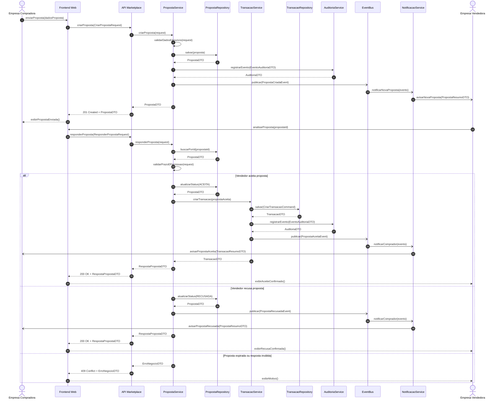
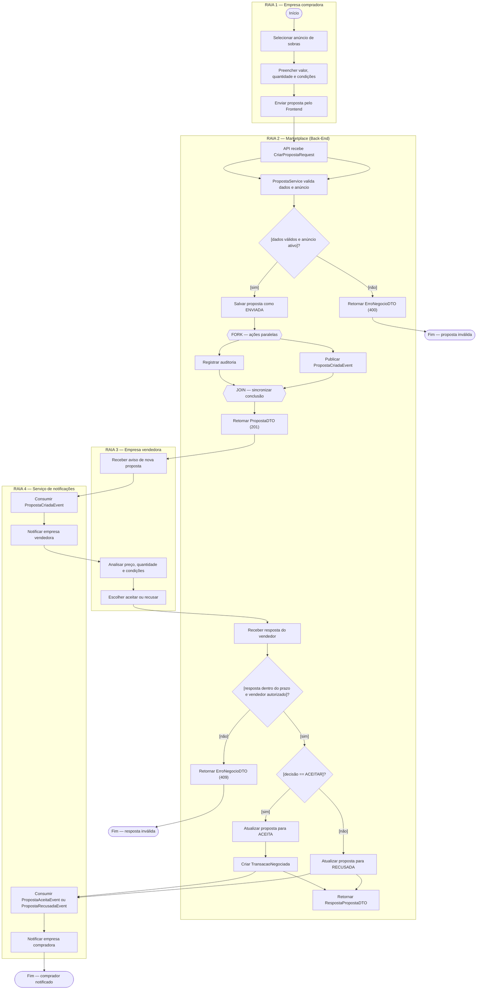
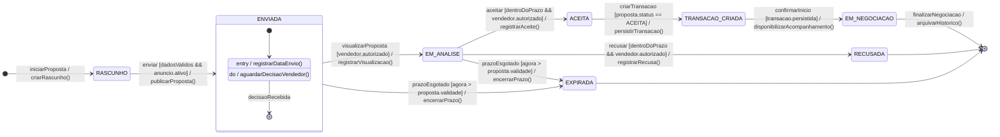
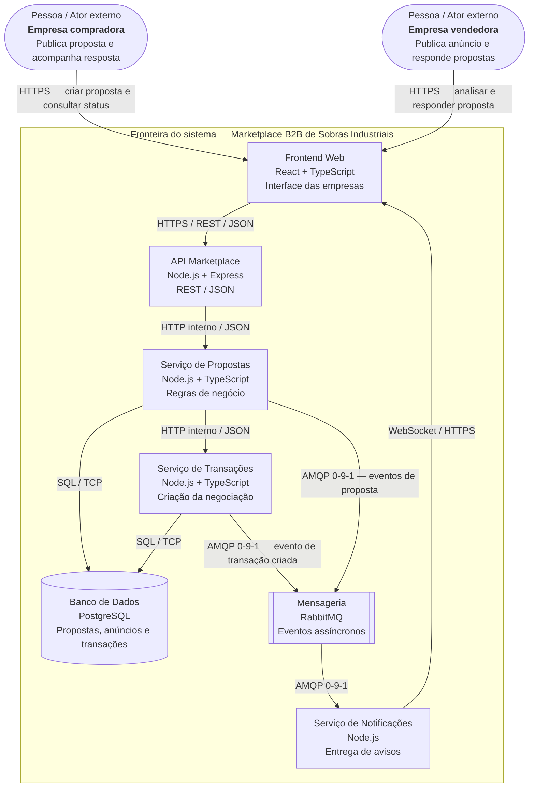

# APS 2 — Dossiê de Arquitetura Viva
## Marketplace B2B de Sobras Industriais
### Fronteiras do sistema e atores externos: empresa compradora e empresa vendedora

**Aluno(a):** EVELYN LOUISE DA SILVA DE SOUZA
**Disciplina:** Engenharia de Software  
**Data:** 06/11/2026

---

## 1. Apresentação e contextualização

Este dossiê modela o domínio Marketplace B2B de Sobras Industriais com foco nas **fronteiras do sistema e nos atores externos**. Os atores externos definidos são:

- **Empresa compradora:** consulta anúncios de sobras industriais, envia propostas e acompanha as respostas.
- **Empresa vendedora:** publica anúncios, recebe propostas e decide aceitar ou recusar cada negociação.

As duas empresas estão fora da fronteira do software. O Marketplace é o sistema que recebe as solicitações, aplica as regras de negócio, persiste os dados e comunica as mudanças de estado.

A funcionalidade crítica selecionada é o **ciclo de envio e resposta de uma proposta comercial**, desde a criação pela empresa compradora até a decisão da empresa vendedora e, quando aceita, a criação da transação negociada.

## 2. Escopo e regras de negócio

### 2.1 Dentro da fronteira do Marketplace

- Receber e validar a proposta enviada pela empresa compradora.
- Verificar se o anúncio está ativo e disponível.
- Registrar a proposta com estado `ENVIADA`.
- Notificar a empresa vendedora.
- Validar se a empresa vendedora tem permissão para responder.
- Registrar aceite ou recusa.
- Criar `TransacaoNegociada` somente quando a proposta for aceita.
- Registrar auditoria e publicar eventos de notificação.

### 2.2 Fora da fronteira do Marketplace

- A empresa compradora decide se deseja enviar uma proposta e informa suas condições comerciais.
- A empresa vendedora analisa as condições e decide aceitar ou recusar.
- As decisões comerciais pertencem às empresas; o Marketplace apenas registra e aplica as regras do fluxo.

### 2.3 Regras de negócio

1. Apenas uma empresa compradora autenticada pode enviar uma proposta em seu nome.
2. A proposta deve referenciar um anúncio ativo.
3. Somente a empresa vendedora proprietária do anúncio pode responder à proposta.
4. A resposta deve ocorrer dentro do prazo de validade.
5. Uma proposta aceita gera uma única `TransacaoNegociada`.
6. Uma proposta recusada ou expirada não gera transação.
7. Toda mudança relevante deve ser registrada para auditoria.
8. Notificações são assíncronas e não substituem a atualização do estado no banco.

---

## 3. Contratos de dados e operações

### 3.1 DTOs principais

| DTO / objeto | Campos principais | Finalidade |
|---|---|---|
| `CriarPropostaRequest` | `anuncioId`, `compradorId`, `valor`, `quantidade`, `condicoes`, `validade` | Dados enviados pelo comprador |
| `PropostaDTO` | `id`, `anuncioId`, `compradorId`, `vendedorId`, `valor`, `quantidade`, `status`, `validade` | Representação da proposta |
| `ResponderPropostaRequest` | `propostaId`, `vendedorId`, `decisao`, `justificativa` | Resposta da empresa vendedora |
| `RespostaPropostaDTO` | `propostaId`, `status`, `respondidaEm`, `mensagem` | Resultado do aceite ou recusa |
| `TransacaoDTO` | `id`, `propostaId`, `compradorId`, `vendedorId`, `valor`, `estado`, `criadaEm` | Dados da transação criada |
| `TransacaoResumoDTO` | `transacaoId`, `propostaId`, `status` | Informação resumida para notificação |
| `PropostaResumoDTO` | `propostaId`, `anuncioId`, `valor`, `quantidade`, `status` | Resumo para avisar a empresa vendedora |
| `EventoAuditoriaDTO` | `eventoId`, `atorId`, `propostaId`, `acao`, `estadoAnterior`, `estadoNovo`, `ocorridoEm` | Histórico auditável |
| `ErroNegocioDTO` | `codigo`, `mensagem`, `referenciaId` | Erros de validação ou permissão |

### 3.2 Operações públicas dos participantes

| Participante receptor | Operação pública | Entrada | Retorno |
|---|---|---|---|
| Frontend Web | `enviarProposta(dadosProposta)` | dados do formulário | ação de interface |
| API Marketplace | `criarProposta(request)` | `CriarPropostaRequest` | `PropostaDTO` |
| PropostaService | `criarProposta(request)` | `CriarPropostaRequest` | `PropostaDTO` |
| PropostaService | `validarDadosEAnuncio(request)` | request | resultado de validação |
| PropostaRepository | `salvar(proposta)` | entidade Proposta | `PropostaDTO` |
| AuditoriaService | `registrarEvento(evento)` | `EventoAuditoriaDTO` | `AuditoriaDTO` |
| EventBus | `publicar(evento)` | evento de domínio | confirmação de publicação |
| NotificacaoService | `notificarNovaProposta(evento)` | `PropostaCriadaEvent` | processamento da notificação |
| API Marketplace | `responderProposta(request)` | `ResponderPropostaRequest` | `RespostaPropostaDTO` |
| PropostaService | `responderProposta(request)` | `ResponderPropostaRequest` | `RespostaPropostaDTO` |
| PropostaRepository | `buscarPorId(propostaId)` | ID | `PropostaDTO` |
| PropostaRepository | `atualizarStatus(status)` | status | `PropostaDTO` |
| TransacaoService | `criarTransacao(propostaAceita)` | proposta aceita | `TransacaoDTO` |
| TransacaoRepository | `salvar(command)` | `CriarTransacaoCommand` | `TransacaoDTO` |
| NotificacaoService | `notificarComprador(evento)` | evento de aceite/recusa | processamento da notificação |

**Regra de consistência:** cada mensagem do diagrama de sequência corresponde a uma operação pública do participante que a recebe. Chamadas internas de validação também estão identificadas como operações do serviço responsável.

---

## 4. Artefato 1 — Diagrama de Sequência (UML / DaC)

O diagrama apresenta os dois atores externos e os componentes internos que recebem suas solicitações. O fragmento `alt/else` representa aceite, recusa ou resposta inválida. As notificações são assíncronas e os DTOs representam os dados de retorno.



### Interpretação

- `Empresa Compradora` inicia o fluxo enviando uma proposta.
- O Marketplace valida os dados e registra a proposta.
- A `Empresa Vendedora` recebe uma notificação e responde.
- Se aceitar, o Marketplace cria uma `TransacaoNegociada`.
- Se recusar, a proposta é encerrada sem criar transação.
- Os retornos são representados por `PropostaDTO`, `RespostaPropostaDTO`, `TransacaoDTO` e `ErroNegocioDTO`.
- `->>` representa chamada síncrona; `-)` representa comunicação assíncrona.

---

## 5. Artefato 2 — Diagrama de Atividades com Raias (UML / DaC)

As raias representam as duas empresas externas, o Marketplace e o serviço de notificações. O Fork/Join representa tarefas independentes após o registro da proposta: auditoria e publicação do evento.



### Interpretação

- As guardas `[sim]` e `[não]` são mutuamente exclusivas em cada decisão.
- O Fork divide o processamento em registro de auditoria e publicação do evento.
- O Join aguarda as duas tarefas antes do retorno de sucesso.
- A empresa vendedora é responsável pela decisão comercial.
- O Marketplace é responsável por validar autorização, prazo e consistência.

---

## 6. Artefato 3 — Diagrama de Transição de Estados (State Machine / DaC)

**Entidade principal:** `Proposta`. O estado `TRANSACAO_CRIADA` indica que o aceite já originou uma `TransacaoNegociada`.



### Regras de integridade

- Uma proposta começa em `RASCUNHO` e só é enviada se os dados forem válidos e o anúncio estiver ativo.
- Apenas o vendedor autorizado pode aceitar ou recusar.
- `ACEITA`, `RECUSADA` e `EXPIRADA` representam resultados da decisão sobre a proposta.
- Somente `ACEITA` pode seguir para `TRANSACAO_CRIADA`.
- A transação é criada uma única vez, com proteção contra requisições repetidas.
- `RECUSADA` e `EXPIRADA` são estados terminais do ciclo da proposta.

---

## 7. Artefato 4 — Visão Arquitetural Macro C4 (Nível 2 — Contêineres)

A visão destaca a fronteira do Marketplace. Empresa compradora e empresa vendedora aparecem fora do limite do sistema como atores externos. Os contêineres internos indicam tecnologias e protocolos.



### Tecnologias e protocolos propostos

| Elemento | Tecnologia | Comunicação |
|---|---|---|
| Frontend Web | React + TypeScript | HTTPS |
| API Marketplace | Node.js + Express | REST / JSON |
| Serviços de Propostas e Transações | Node.js + TypeScript | HTTP interno / JSON |
| Banco de Dados | PostgreSQL | SQL / TCP |
| Mensageria | RabbitMQ | AMQP 0-9-1 |
| Notificações | Node.js | WebSocket / HTTPS |

O arquivo [`docs/architecture/workspace.dsl`](docs/architecture/workspace.dsl) contém a versão em Structurizr DSL da visão de contêineres, com as duas empresas modeladas como pessoas externas ao sistema.

---

## 8. Artefato 5 — Registro de Decisão Arquitetural (ADR 0001)

**Título:** ADR 0001 — Separação das fronteiras entre empresas e Marketplace  
**Status:** Aprovado (decisão arquitetural proposta)

A decisão define as empresas compradora e vendedora como atores externos, com interação exclusivamente pela interface e API do Marketplace. Internamente, a responsabilidade de propostas é separada da criação de transações. A mensageria assíncrona é utilizada para notificações.

O documento completo, com contexto, decisão, consequências, custos e riscos aceitos, está em [`docs/architecture/adr-0001.md`](docs/architecture/adr-0001.md).

---

## 9. Matriz de consistência entre os artefatos

| Conceito | Sequência | Atividades | Estados | C4 / ADR |
|---|---|---|---|---|
| Comprador envia proposta | `criarProposta()` | Enviar proposta | `RASCUNHO → ENVIADA` | Comprador → Frontend |
| Marketplace valida | `validarDadosEAnuncio()` | Decisão de validade | Guarda de envio | API e PropostaService |
| Vendedor responde | `responderProposta()` | Aceitar ou recusar | `EM_ANALISE → ACEITA/RECUSADA` | Vendedor → Frontend |
| Aceite cria transação | `criarTransacao()` | Criar TransacaoNegociada | `ACEITA → TRANSACAO_CRIADA` | Serviço de Transações |
| Notificações | `publicar()` | Serviço de notificações | Não altera estado de negócio | RabbitMQ / AMQP |

---

## 10. Estrutura final de entrega

```text
aps2-nome-sobrenome/
├── docs/
│   ├── architecture/
│   │   ├── workspace.dsl
│   │   └── adr-0001.md
│   └── diagrams/
│       ├── sequencia.mmd
│       ├── atividades.mmd
│       └── estados.mmd
└── README.md
```

## 11. Como visualizar e validar

1. Extraia o ZIP e abra a pasta no VS Code.
2. Instale uma extensão de visualização Mermaid para Markdown.
3. Abra `README.md` e pressione `Ctrl + Shift + V` para visualizar os diagramas.
4. Valide `workspace.dsl` em uma ferramenta compatível com Structurizr DSL.
5. Confira se a stack proposta corresponde à stack definida pelo grupo.

### Sugestão de evolução por commits

- `docs: define fronteiras e atores externos do marketplace`
- `docs: modela sequencia de envio e resposta de proposta`
- `docs: adiciona atividades com raias e fork join`
- `docs: modela estados do ciclo de vida da proposta`
- `docs: adiciona visao C4 e ADR 0001`
- `docs: revisa consistencia entre os artefatos`

Faça commits reais à medida que revisar os arquivos. Não crie histórico artificial ou retroativo.
